<div align="center">

# 🛡️ Wireshark SOC Lab: Identifying a Port Scan and the Attacker's IP

**Investigating a staff report of unusual web server traffic by reading packets like a SOC analyst**
</div>

<p align="center">
  
  
  
  
  
</p>

---

## 📌 Project Overview

This is an **optional** Wireshark SOC lab from the Networkwalks internship. The scenario:

> *You are a SOC analyst. A staff member has reported unusual traffic to your company's web server. Capture the packets and analyze them in Wireshark. Find out what type of attack this is and what the attacker's IP address is.*

The lab runs in the browser. It gives you a Windows 11 PC with Wireshark installed, and you complete **10 tasks** (10 marks each) by capturing traffic, filtering it, and reading the answers from the packets. I followed the lab's written instructions for each task. My final score was **90/100**.

The investigation ends with this finding:

| 🔎 Item        | ✅ Result                                       |
| -------------- | ----------------------------------------------- |
| Attacker       | `192.168.10.66`                                 |
| Target         | Web server `192.168.10.20`                      |
| Ports tried    | 40 (open: 22, 80, 443; closed: 37)              |
| Attack type    | **Port scan**                                   |

---

## 🎯 Objectives

- Capture traffic in Wireshark and read the total packet count.
- Use a display filter to narrow 309 packets down to the ones that matter.
- Find the one IP address behaving differently from every other host.
- Use **Statistics → Conversations** to count how many ports were tried.
- Tell open ports from closed ports using the server's replies.
- Name the attack type from the pattern.

---

## 🛡️ Why This Matters for Security

A port scan is often an early step in an attack: the attacker checks which services a server is running before choosing what to go after. A SOC analyst who can spot a scan in a packet capture can raise the alert before anything else happens.

This lab shows how a scan looks in the packets: one source, a long run of connection attempts to many different ports, all in a fraction of a second, with no data exchanged. Normal hosts look very different.

> ⚠️ **Important:** Port scanning should only be done against systems you own or have explicit permission to test. This lab runs in a simulated environment provided by Networkwalks.

---

## ⚙️ Lab Configuration

| 🧩 Component        | ⚙️ Configuration                                                               |
| ------------------- | ------------------------------------------------------------------------------ |
| 🌐 Platform         | Networkwalks online lab (`networkwalks.com/wireshark-lab3`)                    |
| 🖥️ Analyst PC       | Windows 11 PC in the lab (user `Student`)                                      |
| 🦈 Tool             | Wireshark, capturing on the `WiFi` interface                                   |
| 📦 Capture Size     | 309 packets                                                                    |
| 🧭 Capture Point    | Switch with a SPAN port mirroring traffic to the analyst PC                    |
| 🧑‍💻 SOC Analyst      | `192.168.10.10`                                                                |
| 🗄️ Web Server       | `192.168.10.20`                                                                |
| 🏆 Scoring          | 10 tasks × 10 marks; each hint costs 10% of that task's marks                  |

### Topology (from the lab brief)

```text
SOC Analyst (Wireshark)        Attacker (IP unknown at the start)
 192.168.10.10                          │
        │                               │
        └──────────── Switch ───────────┘
                  (SPAN: packet capture point)
                          │
                   Other hosts, Web Server 192.168.10.20
```

---

# 🪜 Lab Procedure

## Step 1. Sign In and Capture the Traffic (Task 1)

I signed in to the Windows PC, opened Wireshark, and double-clicked the `WiFi` interface to start the capture. The status bar at the bottom shows **Packets: 309**.

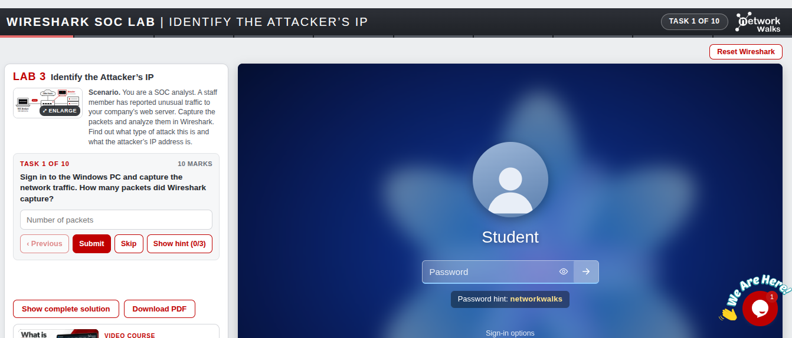

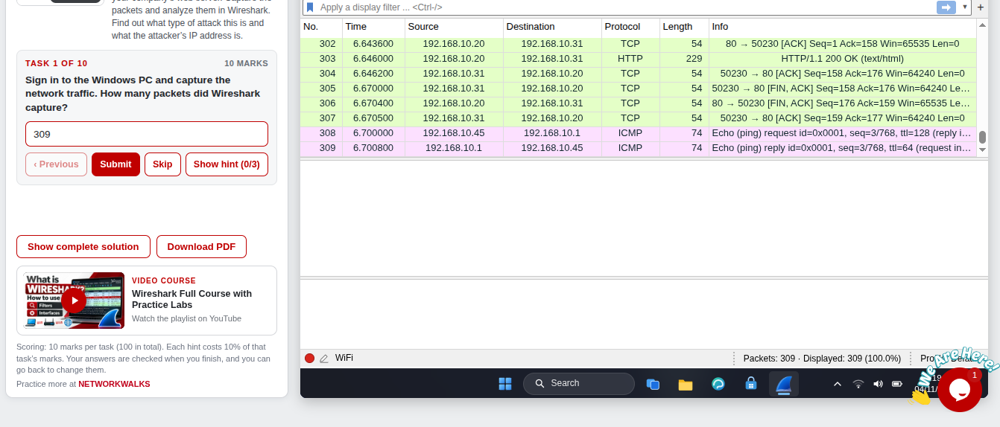

**Answer: 309.** The scrolling list also shows the capture holds a mix of traffic: TCP, HTTP and ICMP.

---

## Step 2. Show Only the SYN Packets (Task 2)

A SYN packet is the first packet of a TCP connection, so filtering on it shows who is *starting* connections:

```text
tcp.flags.syn == 1
```

The status bar shows **Displayed: 73** (23.6% of the capture).

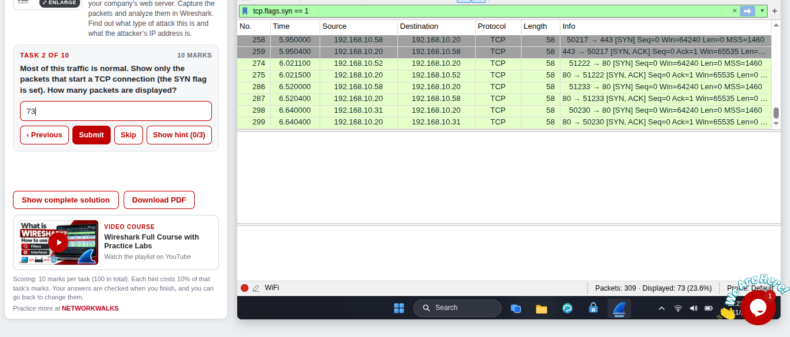

**Answer: 73.**

---

## Step 3. Find the Attacker (Task 3)

With the SYN filter applied, I scrolled through the **Source** column. Most hosts send only one or two SYN packets, but one address sends a long block of them, one after another, starting at about 3.4 seconds: **`192.168.10.66`**. Each of those packets goes to a different port on `192.168.10.20` (3306, 445, 22, 8080 and so on).

I answered this task incorrectly (see *Challenges Encountered*). I submitted `192.168.10.20`, which is the **target**, not the attacker. My screenshot shows the packet details with `Source Address: 192.168.10.66` and `Destination Address: 192.168.10.20`, so the right answer was on screen.

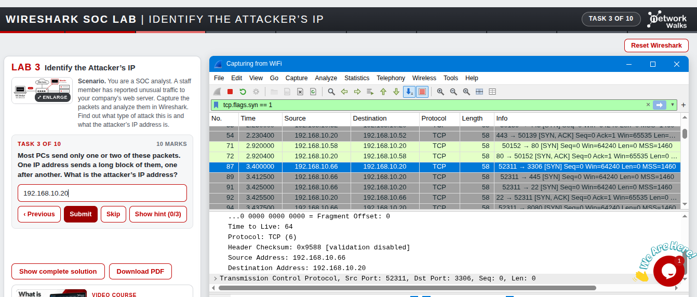

**Correct answer: `192.168.10.66`.** The server, `192.168.10.20`, is the destination of those packets.

---

## Step 4. Find the Target and the Source Port (Tasks 4 and 5)

Using the same SYN view:

- **Task 4, the target:** the **Destination** column of the attacker's packets shows `192.168.10.20`, the web server.
- **Task 5, the source port:** in the Info column, the number before the arrow is the source port. It is **`52311` in every packet** of the block, while the destination port changes each time.

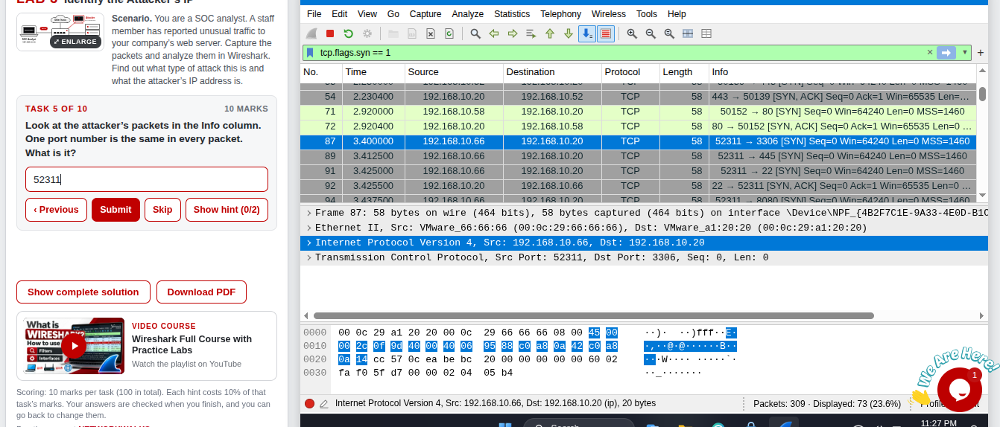

**Answers: `192.168.10.20` and `52311`.** A fixed source port with many different destination ports is what an automated scanning tool produces.

---

## Step 5. Count the Ports Probed (Task 6)

I opened **Statistics → Conversations** and clicked the **TCP** tab. Each row is one conversation, so the attacker's rows with `192.168.10.20` correspond to the ports tried. The tab shows 55 TCP conversations in all, and the attacker's rows list ports such as 3306, 445, 22, 8080, 21, 3389, 139, 80, 25, 5900, 110, 443, 23 and 1433.

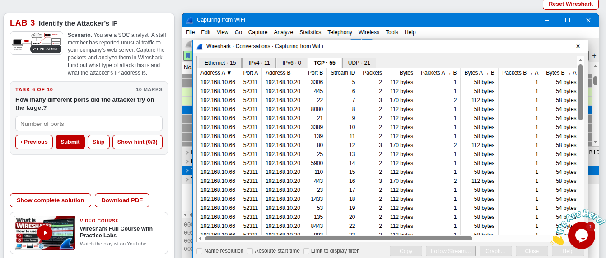

Scrolling down shows the rest of the attacker's ports (6000, 1025, 465, 514, 119, 7, 81, 8008 and 1), followed by the normal hosts such as `192.168.10.58`, `.52` and `.45`.

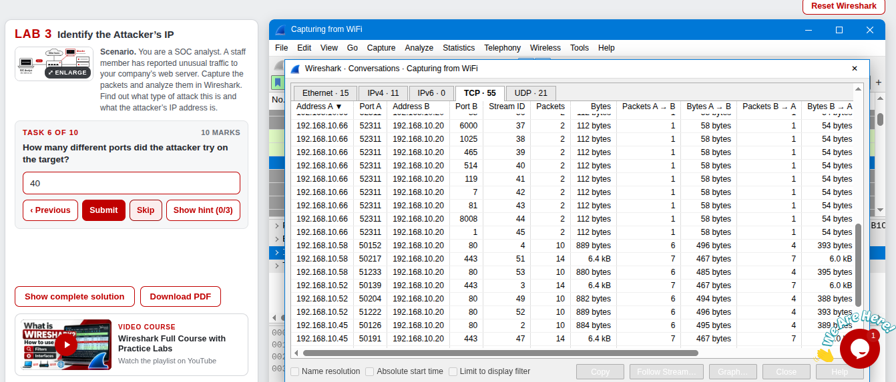

**Answer: 40 ports.**

---

## Step 6. Find the Open Ports (Task 7)

An open port answers a SYN with a **SYN, ACK**. I filtered on the attacker's traffic:

```text
ip.addr == 192.168.10.66
```

Then I looked in the Info column for `[SYN, ACK]` packets coming from the server. The server answers with SYN, ACK only from ports **22, 80 and 443**. Packet 92 in the screenshot is one of them: `22 → 52311 [SYN, ACK]`.

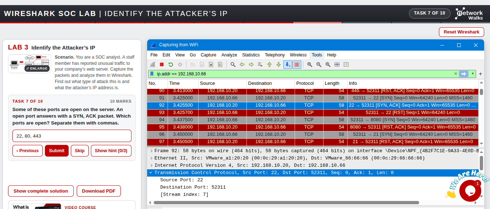

**Answer: 22, 80, 443.**

---

## Step 7. Read the Reply for Closed Ports (Task 8)

For every other port, the server sends back **`RST, ACK`** (a reset), which is how it says the port is closed. In the screenshot, ports 3306 and 445 both get this reply.

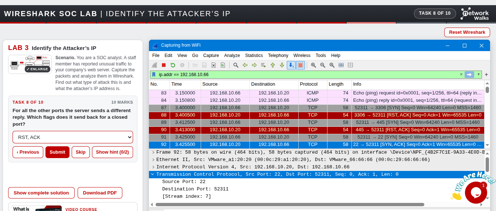

**Answer: RST, ACK.**

---

## Step 8. Count the Closed Ports and Name the Attack (Tasks 9 and 10)

- **Task 9, closed ports:** 40 ports tried − 3 open = **37 closed**. This is a calculation from the earlier answers, so I have no separate screenshot for it.
- **Task 10, attack type:** one IP tried many different ports in a very short time and sent no data. That is a **port scan**. (A SYN flood, in contrast, sends thousands of packets to a single port.)

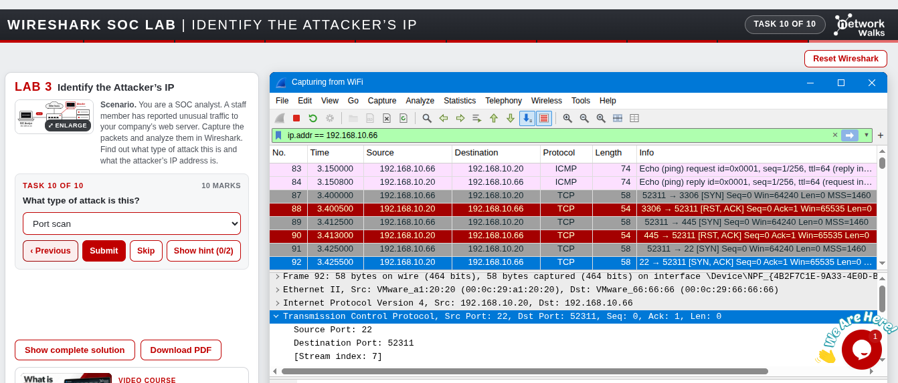

---

## Step 9. Result

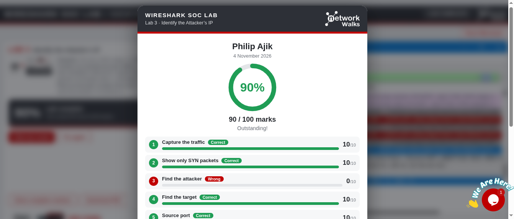

---

# 📊 Results

| #  | 🎯 Task                 | ✅ Answer                        | 🔎 How I Found It                                          | 🏆 Result |
| -- | ----------------------- | -------------------------------- | ---------------------------------------------------------- | --------- |
| 1  | Capture the traffic     | `309` packets                    | Status bar after starting the capture                      | ✅ 10/10  |
| 2  | Show only SYN packets   | `73` displayed                   | `tcp.flags.syn == 1`                                       | ✅ 10/10  |
| 3  | Find the attacker       | `192.168.10.66`                  | Source of the long block of SYN packets                    | ❌ 0/10 (I submitted `192.168.10.20`) |
| 4  | Find the target         | `192.168.10.20`                  | Destination of the attacker's packets                      | ✅ 10/10  |
| 5  | Source port             | `52311`                          | Port before the arrow in the Info column                   | ✅ 10/10  |
| 6  | Ports probed            | `40`                             | Statistics → Conversations → TCP tab                       | ✅ 10/10* |
| 7  | Open ports              | `22, 80, 443`                    | `[SYN, ACK]` replies from the server                       | ✅ 10/10* |
| 8  | Reply for closed ports  | `RST, ACK`                       | Flags in the server's replies                              | ✅ 10/10* |
| 9  | Closed ports            | `37`                             | 40 tried − 3 open                                          | ✅ 10/10* |
| 10 | Attack type             | `Port scan`                      | One IP, many ports, very short time, no data               | ✅ 10/10* |

\* The visible part of my result card covers tasks 1 to 5. Its total of **90/100**, with task 3 as the only task marked wrong, accounts for tasks 6 to 10 as full marks. It also means no hints were used on those tasks, since each hint costs 10%.

### Investigation Timeline (from the packets)

| ⏱️ Time (s) | 📦 Packet | 🔄 What happened                                                              |
| ----------- | --------- | ----------------------------------------------------------------------------- |
| 3.150       | 83 / 84   | `192.168.10.66` pings the web server and gets a reply                         |
| 3.400       | 87        | First SYN of the block: `52311 → 3306`                                        |
| 3.4005      | 88        | Server replies `RST, ACK`: port 3306 is closed                                |
| 3.425       | 91        | SYN to port 22                                                                |
| 3.4255      | 92        | Server replies `SYN, ACK`: port 22 is open                                    |
| 3.4257      | 93        | Attacker sends `RST` and does not complete the connection                     |

---

# 🔭 Observations Beyond the Task Questions

These are things I saw in the screenshots while documenting. The lab does not ask for them.

1. **A ping came first.** Packets 83 and 84 are an ICMP echo request and reply between the attacker and the server, about a quarter of a second before the SYN block. That is consistent with checking whether the host is up before scanning it.
2. **The SYNs are evenly spaced.** Packets 87, 89, 91 and 94 arrive at 3.4000, 3.4125, 3.4250 and 3.4375 seconds, exactly 12.5 ms apart. That regular spacing looks like a tool, not a person.
3. **Open and closed ports look different in Conversations.** Closed ports show 2 packets (112 bytes): the SYN and the `RST, ACK`. The open ports 22, 80 and 443 show 3 packets (170 bytes), because the attacker sends one more packet after the server's `SYN, ACK`.
4. **The attacker never completes the handshake.** After the server's `SYN, ACK` on port 22, the attacker sends a `RST` (packet 93). Dropping the connection like that is how a SYN, or "half-open", scan behaves. The lab only asks me to call it a port scan, so this is extra detail.
5. **Normal hosts look different.** `192.168.10.58`, `.52` and `.45` have conversations on ports 80 and 443 with 10 to 14 packets and between about 880 bytes and 6.4 kB of data. The attacker's conversations carry 112 bytes and no data.

---

# 🐞 Challenges Encountered

I had no technical difficulties with Wireshark or the lab environment. The one thing I got wrong was **Task 3**.

* **Issue:** I submitted `192.168.10.20` as the attacker. That address is the web server being scanned, which is the **Destination** of the attacker's packets. The attacker is the **Source**, `192.168.10.66`.
* **What the evidence showed:** my own screenshot has the attacker's packet selected, with `Source Address: 192.168.10.66` and `Destination Address: 192.168.10.20` side by side.
* **Result:** 0/10 on that task, so the final score was 90/100 instead of 100/100.
* **What I'll do differently:** before submitting, check which column the question is asking about. "Who is sending?" is the Source. "Who is being targeted?" is the Destination. I'll also read the packet details to confirm it.

---

# 💡 Key Learnings

1. **What a port scan looks like in packets:** one source IP, a long run of SYN packets to many different destination ports, a fixed source port, a very short time window, and no data.
2. **Filter first, then read:** `tcp.flags.syn == 1` reduced 309 packets to 73, and the attacker stood out from there.
3. **Source versus Destination matters:** the same packet can answer two different questions, and I need to read the question before choosing the column. I lost marks on exactly this.
4. **Statistics → Conversations is a fast way to count:** it turned "how many ports?" into counting rows.
5. **The server's reply tells you the port state:** `SYN, ACK` means open, `RST, ACK` means closed.
6. **Know what normal looks like:** the other hosts complete their connections and exchange data, so the scanner is visible by contrast.
7. **A scan is different from a flood:** a SYN flood sends thousands of packets to one port, while a scan touches many ports.
8. **Document the mistakes too:** the wrong answer showed me more about reading packets than a perfect score would have.

---

# 🔐 Security & Ethical Use

This lab is for education only and ran in a simulated environment provided by Networkwalks. Port scanning against systems you do not own or have permission to test can be illegal. Practice only in labs and on your own equipment.

---

# 🔗 Tools & Resources

- **Online lab:** [https://networkwalks.com/wireshark-lab3/](https://networkwalks.com/wireshark-lab3/)
- **Wireshark:** [https://www.wireshark.org/download.html](https://www.wireshark.org/download.html)
- **NetworkWalks:** [https://networkwalks.com](https://networkwalks.com)

---

# 👤 Author

**Philip Ajik**  
Cybersecurity Student (Batch B082) — Networkwalks Academy  
LinkedIn: [https://www.linkedin.com/in/philip-ajik-a22944384](https://www.linkedin.com/in/philip-ajik-a22944384)

---

## 📌 Project Information

**Program Name:** Cybersecurity at Networkwalks | **Task:** Wireshark SOC Lab 3 (Optional) | **Project:** Identify the Attacker's IP | **Repository:** GitHub
